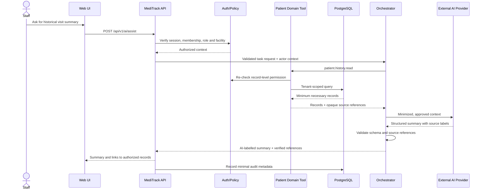

# AI Architecture and Data Flow
**Status:** Proposed; implementation not yet verified

## 1. Components
- **Existing web client:** presents AI assistance as an optional feature.
- **Authenticated REST API:** verifies session and feature entitlement.
- **AI orchestration module:** task routing, policy enforcement, context minimization, schema validation and safe fallback.
- **Domain tools:** narrow functions calling patient, appointment, notification and reporting domain services.
- **Provider adapter:** isolates the application from the external provider's SDK/API.
- **Audit and usage pipeline:** stores minimized event metadata, safety outcomes, latency and cost.
- **External AI API:** receives only approved minimum-necessary context.

## 2. Read-only retrieval flow


## 3. Appointment booking flow
```mermaid
sequenceDiagram
    actor User
    participant API as MediTrack API
    participant AI as Orchestrator
    participant Tools as Appointment Tools
    participant P as External AI Provider
    participant DB as PostgreSQL
    User->>API: Natural-language booking request
    API->>AI: Authorized request
    AI->>Tools: appointment.availability.read
    Tools->>DB: Query authorized service/facility slots
    DB-->>Tools: Current availability
    Tools-->>AI: Real available slots
    AI->>P: Request to explain options
    P-->>AI: Structured options
    AI-->>API: Slot options and required booking details
    API-->>User: Choose and confirm a slot
    User->>API: Confirm proposal
    API->>Tools: appointment.create with bound proposal/idempotency key
    Tools->>DB: Re-check permission and availability; transactional write
    DB-->>Tools: Booking result or conflict
    Tools-->>API: Authoritative outcome
    API-->>User: Confirmed result or ask to select another slot
```

## 4. Trust and data boundaries
1. Client input is untrusted.
2. Authenticated context is constructed by the backend.
3. Tool outputs are limited to fields authorized for that task.
4. Provider input is a controlled disclosure boundary.
5. Provider output is untrusted and must pass schema/source validation.
6. Action confirmation is bound to immutable server-side proposal details.
7. Logs contain metadata, not full records or prompts by default.

## 5. Human approval
- Reads/drafts: may be returned after authorization and validation.
- Booking/cancellation/rescheduling: explicit confirmation by default.
- External message dispatch: staff review/approval in MVP.
- AI summaries: label as AI-generated; staff reviews before consequential reuse.
- Any request with ambiguous patient identity, unclear appointment target or insufficient evidence must ask a clarifying question rather than guessing.

## 6. Failure behavior
| Failure | Expected behavior |
|---|---|
| Provider timeout | Return a retryable error/fallback; do not imply action succeeded |
| Rate limit | Respect bounded retry guidance; show AI temporarily unavailable |
| Invalid model output | Reject it; no action; record validation failure |
| Tool authorization denied | Do not reveal protected data; log policy outcome |
| Appointment slot changed | Return conflict and fresh availability |
| Duplicate request/retry | Idempotency check returns original result or safe status |
| AI disabled | Core patient and appointment workflows continue normally |
| Cost quota exceeded | Disable/throttle AI for applicable scope, not core application |
