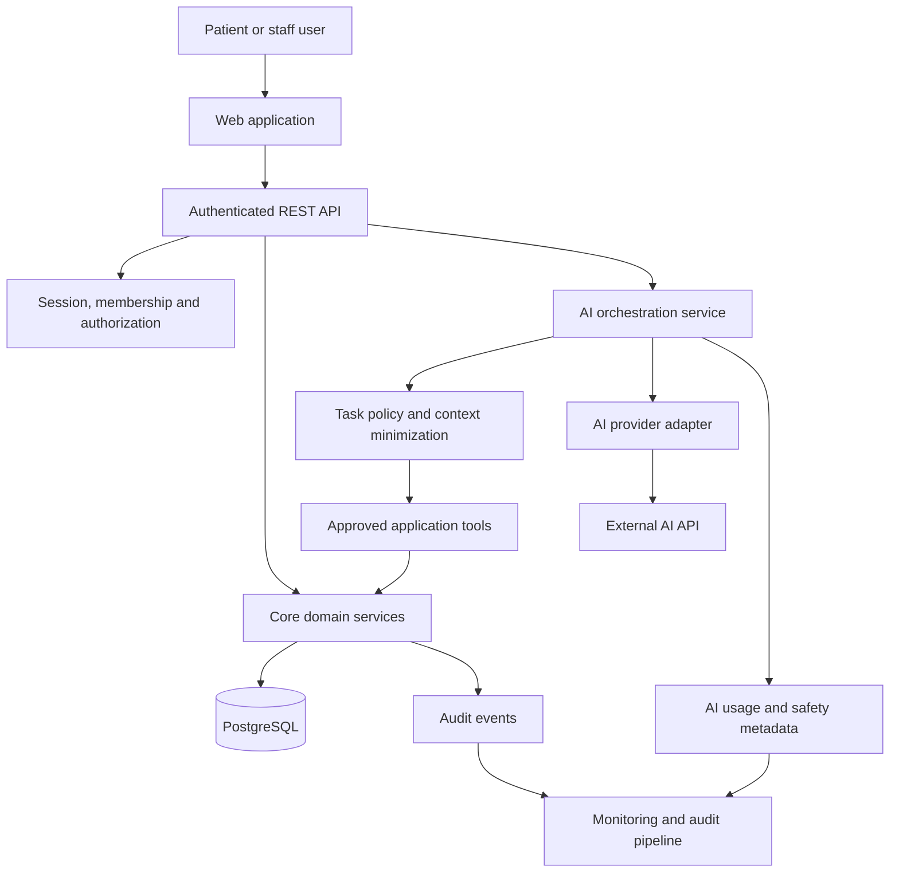
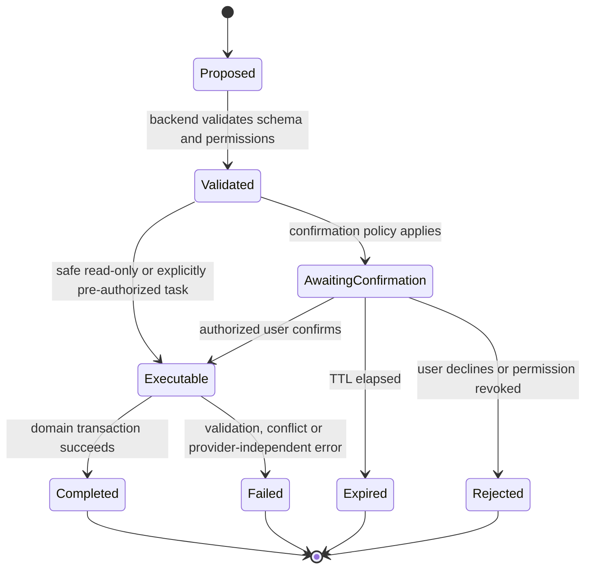

# MediTrack — System Design
**Document status:** Proposed design for review  
**Version:** 2.0  
**Last updated:** 2026-10-22  
**Product:** AI-assisted Patient Appointment and Records Management System  
**Initial market:** Nigeria

> **Design principle:** “AI assists. Authorized humans decide. The application backend enforces permissions and business rules.”

## 1. Purpose and scope

MediTrack is a B2B healthcare operations SaaS product for facilities such as private clinics, hospitals, and diagnostic centres. The initial product manages facilities, staff access, patient records, appointments, and basic administrative workflows. The AI addition is an administrative assistant that helps users complete permitted tasks through existing application capabilities.

This document integrates the AI design into the previously established system direction. It does not claim that the architecture or features are implemented, legally compliant, or production-ready.

### 1.1 Initial AI scope
- **Appointment assistant:** interpret appointment requests, check real availability, suggest slots, and support booking, cancellation, and rescheduling workflows.
- **Patient-record retrieval assistant:** help appropriately authorized staff locate records and produce source-grounded summaries of historical visits.
- **Administrative assistant:** draft reminders, summarize schedules, flag incomplete administrative fields, answer facility-policy questions from approved content, and generate permitted operational summaries.
- **Future only:** duplicate-record suggestions, no-show insights, advanced operational analytics, and additional administrative automation.

### 1.2 Explicit exclusions
The MVP does not include AI diagnosis, autonomous prescribing, clinical decision support, triage, treatment recommendations, or autonomous editing of authoritative clinical records. AI-generated text is not a medical record merely because it is displayed or stored.

## 2. Baseline architecture and certainty

The existing design discussed previously established the following direction. Details marked **confirm** were not evidenced by an inspected repository and must be verified before implementation.

| Area | Current design baseline | Status |
|---|---|---|
| Product model | Multi-tenant B2B healthcare SaaS | Established in prior design |
| Architecture | Modular monolith; avoid premature microservices | Established in prior design |
| Frontend | Next.js, React, TypeScript | Proposed baseline; confirm repository |
| Backend | Node.js, Express, TypeScript, REST API | Proposed baseline; confirm repository |
| Database | PostgreSQL with Prisma ORM | Proposed baseline; confirm repository |
| Tenant model | Organization tenant, facility/location within organization, user plus membership | Established in prior design |
| Authentication | Server-managed sessions and secure cookies | Proposed baseline; confirm implementation |
| Authorization | Server-side role/resource checks and tenant scoping | Required design principle; exact roles to confirm |
| Notifications | Administrative reminders/messages are in scope; delivery provider not selected | Provider unresolved |
| Audit | Audit events for important security and business actions | Required direction; implementation details to confirm |
| Hosting/observability | Managed deployment, health monitoring, backups and recovery planning | Provider and topology unresolved |
| AI provider | External paid API, provider not selected | Selection intentionally deferred |

Before implementation, compare this baseline against the actual repository and record discrepancies. Do not replace established repository choices merely to match this document.

## 3. Product and domain boundaries

### 3.1 Core application modules
1. **Identity and access:** users, sessions, memberships, role/permission checks, recovery and revocation.
2. **Organization and facilities:** tenant settings and facility configuration.
3. **Patient management:** patient registration, search, demographic and administrative data.
4. **Appointments:** scheduling, availability, booking, cancellation, rescheduling and status.
5. **Records retrieval:** authorized access to existing patient history; clinical scope remains limited to records already supported by the product.
6. **Notifications:** reminder/confirmation drafts and delivery through a separately selected provider.
7. **Subscription and billing:** plan lifecycle and billing boundaries.
8. **Audit and operations:** security events, administrative events, metrics, backups and incident response.
9. **AI integration:** optional layer that calls approved application functions; it does not own core business truth.

AI must not become a parallel patient database or appointment scheduler. The existing domain services remain the source of truth.

## 4. High-level architecture

### 4.1 Architectural choice
Keep the existing modular-monolith direction. Implement AI orchestration as a module/service boundary inside the existing backend unless measured scaling, deployment, or security requirements justify a separate service. Do not add a vector database, message broker, agent framework, or microservice solely because AI is introduced. Add infrastructure only when a concrete requirement and operational owner justify it.

### 4.2 Trust boundaries
- **TB1 — Client to application:** all client input is untrusted.
- **TB2 — Application to tenant data:** access must be tenant- and facility-scoped on the server.
- **TB3 — AI orchestration to domain tools:** model proposals are untrusted; tools independently authenticate, authorize, validate, and enforce business rules.
- **TB4 — Application to external AI provider:** only approved, minimum-necessary context crosses this boundary under reviewed contractual and technical safeguards.
- **TB5 — Logs and analytics:** logs are sensitive operational data and must not become a secondary patient-record store.
- **TB6 — Staff review and execution:** a confirmation is valid only when bound to an authenticated user, authorized action, current target, and unexpired proposal.

## 5. AI request lifecycle

1. The user signs in through the existing authentication mechanism.
2. The API checks that the feature is enabled for the organization and user.
3. The backend establishes tenant, facility, role, and permitted task context from the authenticated session—not from model-supplied claims.
4. The orchestrator classifies the request into a supported task and applies input, rate, and cost limits.
5. It calls only the task workflow's approved tools to obtain current facts. It does not query the database directly.
6. A context-minimization step removes irrelevant fields and replaces direct identifiers with opaque references where practical.
7. The provider adapter submits a structured request to the selected external provider.
8. The response is parsed and validated against a schema and task-specific safety rules.
9. Source references are resolved by the backend. The model cannot fabricate or authorize its own references.
10. Read-only results may be shown with an AI-generated label and appropriate citations. Mutating actions create a proposal or confirmation request when required.
11. On confirmation, the backend re-checks authorization, current state, business rules, expiration, and idempotency before executing the operation.
12. The outcome and minimal audit metadata are recorded. Core non-AI workflows remain available if any AI stage fails.

## 6. AI components

### 6.1 AI orchestration service
Responsibilities:
- Accept authenticated requests for allowlisted tasks.
- Apply task policy, rate limits, context limits, and tenant boundaries.
- Select a fixed workflow and permitted tools.
- Prepare minimum-necessary context.
- Invoke the provider adapter.
- Validate structured output and source references.
- Return a response, clarification request, or action proposal.
- Apply deadlines, bounded retries, cancellation, and fallback behavior.
- Emit privacy-preserving operational telemetry.

It must not make final authorization decisions based on model output. The model may propose a tool call; the backend independently decides whether that operation is permitted.

### 6.2 Provider adapter
Define an internal interface with normalized inputs and outputs. A provider-specific implementation translates the internal contract to the selected provider API. Keep provider-specific SDK types out of domain modules.

Responsibilities:
- Authentication to provider using server-side secret management.
- Explicit model/configuration selection.
- Request/response translation.
- Timeout and cancellation.
- Error normalization and rate-limit interpretation.
- Usage metadata and estimated cost reporting where available.
- Provider health and version/configuration telemetry.
- No logging of secrets or unnecessary prompt content.

The interface should allow a second adapter to be added without changing appointment or patient domain logic. Avoid an elaborate plugin framework until there is a real need.

### 6.3 Controlled backend tools
Tools are ordinary server-side application functions, not direct database handles. Each tool:
- Receives authenticated actor and tenant context from the server.
- Uses a narrow input schema and strict limits.
- Enforces organization/facility scope and resource permissions.
- Uses domain services and transactions for state changes.
- Returns only fields necessary for the task.
- Emits audit events for sensitive reads and all writes.
- Rejects unknown fields, invalid identifiers, ambiguous matches, and stale state.

Never pass database credentials, unrestricted SQL, ORM clients, arbitrary URLs, or general-purpose shell/network tools to the model.

### 6.4 Response validation
- Require structured JSON/schema-constrained outputs where supported.
- Validate all fields server-side; treat all model output as untrusted.
- Reject invalid enum values, unexpected fields, oversized content, invalid references, or unsupported claims.
- For summaries, map each cited source reference to an authorized record the backend actually retrieved.
- Distinguish “not documented in the retrieved records” from “does not exist.”
- If validation fails, return a safe fallback or ask the user to retry; do not execute an action.
- Escape output in the UI and prevent model output from being interpreted as HTML, code, or executable instructions.

## 7. Authentication, authorization and tenant isolation

Reuse the existing authentication system. Do not introduce a separate AI identity model that bypasses normal access control.

- Derive actor, organization, facility and membership from verified server-side session/context.
- Verify membership and resource permission on every tool invocation.
- Do not trust a patient ID, organization ID, facility ID, role, or permission asserted by the browser or model.
- Scope patient searches and appointment queries by authorized tenant/facility.
- Use generic not-found/forbidden behavior where necessary to avoid leaking record existence.
- Re-check access when a confirmation is submitted; permissions may have changed after a proposal was created.
- Enforce access for exports, summaries, notifications and cached results as well as normal reads.
- Cache only when keys include the required tenant/facility/permission context; safest MVP default is not to cache patient-specific AI results.
- Evaluate PostgreSQL row-level security as defense in depth only after verifying compatibility with Prisma, connection pooling and transaction-scoped tenant context. It is not a substitute for application checks.
- Cross-tenant access is denied by default. Cross-facility sharing requires a documented legal basis, product policy, and explicit authorization.

## 8. AI use cases and execution policy

| Use case | AI may do | Backend/human control |
|---|---|---|
| Appointment availability | Interpret intent and present real slots | Availability comes from scheduling domain service |
| New booking | Propose a booking from validated details | User confirmation required by default; re-check slot and use idempotency key |
| Cancellation | Prepare a cancellation request | Confirm target and consequences; authorized user confirms |
| Rescheduling | Propose a new slot | Confirm old/new appointment; transactionally re-check both |
| Patient search | Suggest search criteria | Server restricts results to authorized scope; ambiguous identity requires clarification |
| Visit summary | Summarize retrieved authorized records | Source-grounded; AI-labelled; staff reviews before reuse in consequential contexts |
| Reminder draft | Draft message | Verify recipient/channel and consent/preferences; staff approval before external dispatch in MVP |
| Daily schedule summary | Summarize authorized appointments | Backend supplies scoped data; staff-only; avoid unnecessary identifiers |
| Incomplete administrative records | Flag missing required fields | Rule-based checks identify missing fields; AI may explain or group findings |
| Facility FAQ | Answer from approved facility content | Restrict to approved source; show when answer is unavailable |
| Operational summary | Summarize aggregated permitted metrics | Minimum group sizes and permission checks; no unsupported causal claims |

## 9. Human approval and action state machine

A proposal must be bound to the authenticated actor, tenant/facility, operation, target resource, normalized arguments, relevant version/state, expiry, and one-time nonce. A client must not be able to alter arguments after approval. The backend must revalidate the target's current state and permissions at execution time.

**Default MVP policy:** reads and drafts can return directly if authorized; any creation, cancellation, rescheduling, or external message dispatch initiated through AI requires explicit confirmation. This policy may be refined by a documented risk review, not by the model itself.

## 10. Data model impact

The existing core entities remain authoritative: Organization, Facility, User, Membership, Patient, Service, Appointment, SubscriptionPlan, Subscription, Invoice, Payment, AuditEvent and Notification (confirm actual names against repository).

AI additions should be minimal and must not duplicate patient records.

### 10.1 Proposed optional metadata entities
- **AIInteraction:** opaque ID, tenant/facility, actor ID, task type, status, created/finished timestamps, provider/model identifier, prompt-template version, latency, token/cost metadata, safety/validation outcome, and correlation ID. Avoid storing full raw prompts by default.
- **AIActionProposal:** opaque proposal ID, tenant/facility, actor, action type, normalized action payload or reference to server-side short-lived payload, target resource reference, status, expiry, confirmation actor/time, idempotency key and execution result reference. Sensitive payload retention must be limited.
- **AISourceReference:** interaction/proposal reference, source type, opaque source ID, record version/timestamp and citation label. Re-check authorization when displayed. Store references, not copied clinical content.
- **AIUsageLedger** (may be a table or an existing metering service): provider/model, usage counts, estimated cost, tenant, task and timestamp. Restrict access and avoid storing content.
- **AuditEvent extension:** event type and correlation ID for AI request, source record access, proposal, approval, execution, failure and policy rejection.

Do not add all tables automatically. First inspect existing AuditEvent, Notification and usage/billing structures. Reuse suitable structures where they preserve clear access controls and retention. Generated summaries should be ephemeral by default. If a reviewed summary is stored, mark it as AI-generated draft with source references, author/reviewer, timestamps and status; never overwrite authoritative records.

## 11. Proposed API additions

Use the repository's established versioning, error envelope, authentication and naming conventions. The routes below are proposals, not implemented endpoints.

### 11.1 Public application endpoints
- `POST /api/v1/ai/assist` — submit a supported administrative request.
- `GET /api/v1/ai/interactions/:interactionId` — retrieve status/result for an authorized interaction if asynchronous processing is required.
- `POST /api/v1/ai/action-proposals/:proposalId/confirm` — confirm a pending action.
- `POST /api/v1/ai/action-proposals/:proposalId/reject` — reject a pending action.
- `GET /api/v1/ai/usage` — authorized organization-level usage summary for billing/admin roles, if product requirements call for it.

Detailed contracts are in `AI_API_AND_TOOL_CONTRACTS.md`.

### 11.2 Internal tool contracts
Internal tools are not directly exposed as unrestricted public endpoints. They call existing domain services and require the authenticated actor context:
- `patient.search`
- `patient.history.read`
- `appointment.availability.read`
- `appointment.create`
- `appointment.cancel.request`
- `appointment.reschedule.request`
- `schedule.summary.read`
- `admin.incomplete-records.read`
- `facility.faq.search`
- `notification.draft.create`

The model selects only from task-allowlisted tools. It cannot pass an arbitrary tool name or broaden its own permissions.

## 12. External AI provider selection and data handling

No provider is selected in this design. Selection must follow a documented review and ADR.

### 12.1 Provider due diligence
Verify, contractually and technically:
- Whether submitted data is used for model training, and whether opt-out is contractually available.
- Retention for prompts, outputs, abuse monitoring, support and backups; deletion process and timing.
- Data processing agreement and subprocessor list.
- Processing/storage regions and international transfer mechanisms.
- Encryption in transit and at rest; key management and incident notification.
- Access controls, staff access, security assurance reports and independent assessments.
- Availability, rate limits, service-level commitments and support response.
- Model/version change notification, deprecation and reproducibility options.
- Data export/deletion, audit support and termination provisions.
- Costs, token limits, usage metering and overage controls.
- Restrictions relevant to sensitive health information and the intended use case.

Marketing statements are not sufficient evidence. Paid API access does not itself guarantee confidentiality, non-retention, non-training, Nigerian legal compliance or an appropriate international-transfer basis.

### 12.2 Data minimization policy
- Send only fields needed for the current task.
- Prefer opaque patient/appointment references and derived facts over names, phone numbers, addresses, national identifiers and full records.
- Do not send direct identifiers unless the task genuinely requires them and privacy/legal review has approved the purpose, provider terms, transfer path and safeguards.
- Do not send entire patient histories when a narrow date range or selected visit fields suffice.
- Do not send passwords, session cookies, access tokens, payment credentials or secrets.
- Do not assume pseudonymized data is anonymous; re-identification may remain possible.
- Do not send real patient data in development or evaluation datasets unless a formal approval and controls process authorizes it. Prefer synthetic data.

### 12.3 Secrets and encryption
- Store provider credentials in deployment secret management; never in source code, client bundles, logs or database records readable by ordinary users.
- Restrict secret access to the backend runtime; rotate on a schedule and immediately after suspected exposure.
- Require TLS for provider and application traffic.
- Encrypt persistent data and backups at rest using managed controls where available.
- Define key access, rotation and recovery responsibilities with the hosting provider.

## 13. Privacy, legal and regulatory considerations

The Nigeria Data Protection Act 2023 and applicable NDPC instruments/guidance are relevant to personal data processing. Health information is sensitive personal data and requires heightened care. Before processing real patient data through an external provider, qualified Nigerian privacy/legal professionals should assess lawful basis, purpose limitation, transparency, data-subject rights, controller/processor roles, DPIA obligations, security, retention, breach response, and international transfers.

Also review applicable healthcare confidentiality, professional duties and sector-specific record-handling obligations for the actual facility customers and records being processed.

This design is not a legal opinion or certification of compliance. Encryption, consent screens, audit logs or a provider's paid tier do not alone establish compliance. Record the outcome of a Data Protection Impact Assessment or equivalent documented risk assessment before a real-data pilot.

## 14. Prompt injection and untrusted content

- Treat user text, retrieved patient records, facility documents and provider outputs as untrusted.
- Retrieved content is evidence/data, not instruction authority.
- Do not place retrieved text in a position that can override system policy or tool permissions.
- Keep system policy and task instructions separate from quoted data where provider format supports it.
- Use fixed tool allowlists and narrow schemas.
- Validate all tool arguments and reauthorize every operation.
- Do not let the model browse arbitrary URLs, execute code, access secrets, or call general-purpose database tools.
- Bound context length and output size.
- Escape generated content in the UI.
- Test indirect prompt injection contained in records, appointment notes and facility documents.

Prompt engineering is supplementary; authorization, isolation and execution rules belong in trusted backend code.

## 15. Reliability and fallback

- AI is an optional capability; core patient and appointment CRUD must work without it.
- Apply an overall deadline and per-provider request timeout. Set values through configuration and validate them in load tests.
- Retry only transient errors, with a small bounded attempt count and exponential backoff/jitter; do not blindly retry non-idempotent operations.
- Use circuit breaking or temporary disablement if repeated provider failures threaten the core API.
- Handle HTTP 429 using provider retry guidance and bounded scheduling; do not create retry storms.
- If a provider response is uncertain after a mutating operation, query the domain state using a correlation/idempotency key before attempting again.
- Appointment booking uses a server-generated or securely bound idempotency key and a database transaction/unique constraint where appropriate.
- Re-check slot availability immediately before booking.
- A provider timeout must not imply that a booking succeeded or failed; show a safe uncertain status and query authoritative application state.
- Do not silently change an appointment, send a message, or modify data after a failed AI call.
- Return a useful fallback: normal forms, direct search, manual scheduling and existing workflows.

## 16. Audit, telemetry and retention

Record metadata necessary for security, operations and cost management:
- Actor ID, tenant/facility ID, task type and correlation ID.
- Tool names and outcome; source record identifiers or appropriately protected references.
- Approval required/obtained, approving actor, and action outcome.
- Provider/model version, prompt-template version, latency, error category and usage/cost estimate.
- Validation, safety and policy rejection events.

Do not log full patient records, complete sensitive prompts or responses by default, authentication secrets, or unnecessary identifiers. Use structured logs with redaction and access controls. Separate application audit events from provider-cost metrics if they have different access and retention needs.

Retention periods must be defined with the privacy owner and customer contracts. Provide a documented deletion and legal-hold process. Restrict log access, monitor access to logs, and test that redaction works. Any temporary prompt/response retention for debugging must be opt-in, time-limited, access-restricted, and approved for the data class.

## 17. Security and operational requirements

- Authentication and authorization are checked on every request and tool call.
- Tenant isolation tests cover reads, writes, searches, exports, summaries, caches and confirmation endpoints.
- API input validation, output encoding, rate limiting and request-size limits are applied.
- AI requests have per-user, per-tenant and global quotas and maximum context/output sizes.
- Monitor cost by tenant/task and define spend alerts and hard limits.
- Apply least-privilege access to database, deployment, provider credentials, logs and support tools.
- Production support access to patient data is disabled by default and must be time-bound, approved and audited.
- Backups and restoration are tested; define RPO/RTO with the business owner before launch.
- Security incidents involving provider disclosure are included in the incident response plan.
- Feature flags allow AI to be disabled per tenant or globally without disabling core operations.
- Dependency scanning, code review, secret scanning, CI tests and release approvals are required.
- Confirm that health checks, metrics and alerting avoid sensitive payloads.

## 18. Deployment view

The proposed deployment remains deliberately simple:
- Web frontend.
- Node.js/TypeScript backend modular monolith.
- PostgreSQL.
- Existing managed hosting, secret management, logs/metrics and backup services once selected.
- External AI API reached only by the backend over TLS.
- Existing notification/payment providers remain independently selected and isolated.

The browser must never call the paid AI provider directly. No provider key or privileged tool token may be shipped to the client. A separate AI service, queue, or vector store is a future architecture decision, not an MVP assumption.

## 19. Non-functional requirements and proposed release gates

These are proposed acceptance targets to confirm against actual expected load and budget:
- Core appointment and patient workflows continue to operate with AI disabled or unavailable.
- 100% of AI tool invocations are authorized server-side and correlated to an authenticated actor and tenant.
- 0 cross-tenant disclosures in automated authorization tests.
- 0 appointment writes from AI without a valid, unexpired confirmation and successful final business-rule validation under the default MVP policy.
- 100% of generated patient-summary source references resolve to records retrieved for that authorized request.
- 0 unsupported clinical claims in the approved evaluation set; any critical fabricated diagnosis, medication or allergy is a release blocker.
- AI provider secrets never appear in client bundles or application logs.
- Cost and request-rate limits are enforced in tests.
- Provider timeout and rate-limit tests demonstrate safe fallback.
- Performance SLOs, RPO/RTO and availability targets must be set after baseline measurement and hosting selection; they are not invented here.

## 20. Unresolved decisions

1. Confirm the actual repository stack, routes, naming, roles and auth implementation.
2. Which facility types and workflows are in the first pilot?
3. Is a patient allowed to interact with AI directly, or is the first release staff-only? Recommended: staff-first; patient-facing AI only after separate privacy, identity and workflow review.
4. Which roles can search records and request summaries?
5. Which patient identifiers and minimum demographics may be searched?
6. What appointment conflict, duration, service and provider rules already exist?
7. Which payment/notification/hosting providers are selected?
8. Which AI provider and exact model pass due diligence?
9. Are provider retention and training terms acceptable for the intended data?
10. Which regions process and store data, and what transfer safeguards apply?
11. What is the AI log retention period and who is the data owner?
12. What are the RPO/RTO, availability, latency and cost ceilings?
13. Will PostgreSQL row-level security be adopted after compatibility testing?
14. What customer-facing AI disclosures and staff training are required?
15. What process governs customer data export, deletion and tenant suspension?

## 21. Related documents

- `docs/AI_ARCHITECTURE_AND_DATA_FLOW.md`
- `docs/AI_THREAT_MODEL.md`
- `docs/AI_API_AND_TOOL_CONTRACTS.md`
- `docs/RESPONSIBLE_AI_REQUIREMENTS.md`
- `docs/AI_EVALUATION_AND_TESTING_PLAN.md`
- `docs/AI_IMPLEMENTATION_ROADMAP.md`
- `docs/ADR/ADR-001-external-ai-provider.md`
- `docs/ADR/ADR-002-provider-adapter.md`
- `docs/ADR/ADR-003-controlled-ai-tools.md`
- `docs/ADR/ADR-004-human-approval.md`
- `docs/ADR/ADR-005-patient-data-handling.md`
- `docs/ADR/ADR-006-ai-audit-retention.md`
- `docs/ADR/ADR-007-failure-fallback.md`
